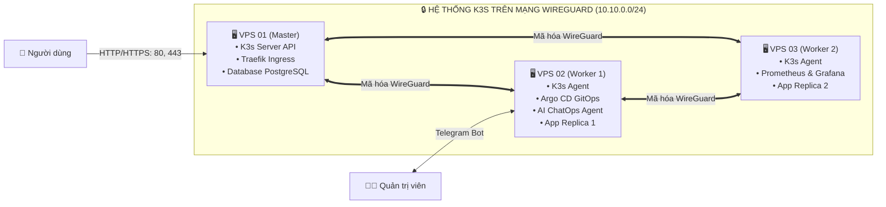

# TỔNG QUAN KIẾN TRÚC HỆ THỐNG
---

## 1. vấn đề và Thách thức

Việc triển khai hệ thống Kubernetes trên hạ tầng máy chủ ảo (VPS) độc lập với ngân sách tài nguyên nhỏ gặp các vấn đề sau:

1. ** Giới hạn tài nguyên Control Plane:** Kubernetes tiêu chuẩn (K8s) đòi hỏi cấu hình tối thiểu cao (thường chiếm 1.5GB – 2.5GB RAM chỉ để duy trì `etcd`, `kube-apiserver`, `kube-controller-manager`), làm giảm đáng kể tài nguyên phục vụ cho ứng dụng thực tế.
2. **Thiếu hạ tầng mạng LAN riêng:** Do các VPS được thuê độc lập từ nhà cung cấp dịch vụ cloud và chỉ có địa chỉ Public IP riêng biệt, nếu kết nối các node K8s trực tiếp qua Internet public sẽ tiềm ẩn nguy cơ bảo mật nghiêm trọng (lộ cổng API 6443, traffic giữa các Pod không được mã hóa).
3. **Rủi ro vận hành CI/CD:** Phương pháp CI/CD dạng Push-based (đẩy mã từ GitHub Actions vào cụm) yêu cầu lưu chứng thực `kubeconfig` trên server CI bên ngoài và không có cơ chế tự động phát hiện lệch cấu hình.
4. **Vận hành và xử lý khi có sự cố:** Khi Pod gặp lỗi (`CrashLoopBackOff`, `OOMKilled`), cần truy cập máy chủ, tra cứu log, làm tăng thời gian phục hồi dịch vụ.

---

## 2. Kiến trúc giải pháp đề xuất

Mô hình kiến trúc tích hợp từ 3 VPS trở lên:

---

## 3. Công nghệ sử dụng

1. **Điều phối container:** K3s (Rancher Labs), phiên bản phân phối Kubernetes tối ưu tài nguyên.
2. **Bảo mật mạng:** WireGuard Full Mesh VPN, thiết lập mạng riêng ảo mã hóa (`10.10.0.0/24`).
3. **Tường lửa:** CSF (ConfigServer Security & Firewall) và tiến trình LFD (Login Failure Daemon).
4. **GitOps:** Argo CD theo mô hình Pull-based.
5. **Giám sát:** Prometheus và Grafana tập trung trên Worker 2.
6. **Trợ lý vận hành (ChatOps):** Mô hình Multi-Agent, tích hợp Telegram Bot.
