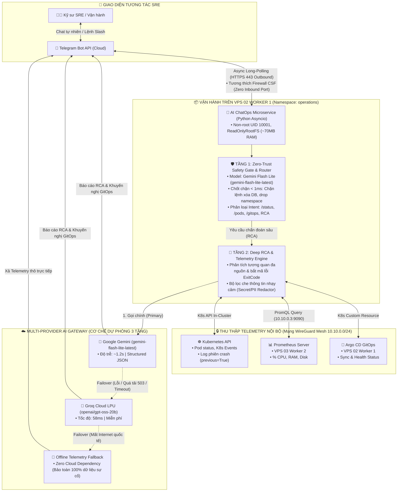

# BÁO CÁO NGHIÊN CỨU: TRỢ LÝ VẬN HÀNH THÔNG MINH AI CHATOPS

- **Sinh viên thực hiện:** Đinh Hồng Phong - 24TX810013
- **Nội dung:** Khảo sát bài toán AIOps, thiết kế mô hình Multi-Agent

---

## 1. Vấn đề vận hành Kubernetes
Trong vận hành hệ thống container, khi xảy ra sự cố (Pod crash, CrashLoopBackOff, OOMKilled do tràn bộ nhớ, lỗi ImagePullBackOff), người vận hành thường mất nhiều thời gian cho các bước thủ công:
1. Nhận cảnh báo và đăng nhập vào máy tính.
2. Chạy lệnh `kubectl describe pod`, `kubectl logs`, kiểm tra `events`.
3. Phân tích nguyên nhân gốc (Root Cause Analysis - RCA) dựa trên kinh nghiệm cá nhân.

Quá trình này làm thời gian gián đoạn dịch vụ (MTTR) tăng lên. Việc ứng dụng trí tuệ nhân tạo (AI/LLM) để hỗ trợ chẩn đoán và vận hành tự động (AIOps / ChatOps) giúp người vận hành hệ thống nắm tình hình, xử lý nhanh chóng hơn.

---

## 2. Kiến trúc Multi-Agent & Cơ chế Dự phòng Đa tầng (High-Availability Failover)

Mô hình ChatOps hoạt động như một microservice bất đồng bộ (`asyncio`) tối ưu trên Pod Kubernetes (VPS 02 Worker 1), kết nối Telegram qua Outbound Long-Polling và bảo vệ bằng kiến trúc AI Gateway 3 tầng kết hợp mạng riêng ảo WireGuard Mesh:

---

## 3. Vai trò và Cơ chế Phối hợp của từng Tầng

### 3.1. Tầng 1: Zero-Trust Safety Gate & Intent Router Agent
- **Đặc tính kỹ thuật:** Phản xạ tức thì (độ trễ 300ms – 1.2s), ràng buộc cấu trúc dữ liệu JSON chặt chẽ.
- **Nhiệm vụ:**
  - **Chốt chặn an toàn (Policy Gate):** Quét lệnh người dùng; chặn đứng ngay lập tức các hành vi nguy hiểm (`delete`, `drop database`, sửa `cluster-admin`) hoặc kỹ thuật tấn công Prompt Injection/Jailbreak mà không tốn token LLM.
  - **Định tuyến thông minh:** Phân loại câu hỏi thành các hành động tra cứu nhanh (`CLUSTER_OVERVIEW`, `APP_PODS_STATUS`, `ARGOCD_STATUS`) hoặc chuyển tiếp sang Tầng 2 khi cần phân tích nguyên nhân sự cố chuyên sâu (`DEEP_DIAGNOSIS_RCA`).

### 3.2. Tầng 2: Root Cause Analysis (RCA) & Telemetry Agent
- **Đặc tính kỹ thuật:** Phân tích tương quan đa nguồn, chịu lỗi đa tầng (Multi-Provider Failover).
- **Nhiệm vụ:**
  - **Thu thập dữ liệu Telemetry an toàn:** Tự động gom K8s Events, trích xuất log container (bao gồm cờ `previous=True` để bắt đúng log lúc tiến trình bị tắt/crash), truy vấn Prometheus qua mạng nội bộ WireGuard và lọc sạch thông tin nhạy cảm qua `Secret/PII Redactor`.
  - **Phân tích nguyên nhân gốc rễ (RCA):** Kết hợp trí tuệ nhân tạo (Google Gemini làm chính, tự động chuyển sang Groq khi quá tải) để chẩn đoán chính xác mã lỗi (`ExitCode=0`, `ExitCode=137 OOMKilled`), trạng thái Kubelet tự phục hồi và đưa ra khuyến nghị xử lý chuẩn GitOps gửi về Telegram.

---

## 4. Ưu điểm kỹ thuật nổi bật
1. **Tiết kiệm tài nguyên tuyệt đối (0% GPU, ~70MB RAM):** Không tốn phần cứng GPU đắt tiền để tự host LLM. Agent được đóng gói multi-stage với `uv`, chỉ tiêu thụ khoảng 60–80MB RAM trên VPS Worker 1.
2. **Bảo mật mạng chuẩn Enterprise (Không mở cổng Inbound):** Sử dụng cơ chế kéo tin nhắn Outbound Long-Polling chiều ra HTTPS 443, tương thích tuyệt đối với tường lửa CSF đóng toàn bộ cổng Inbound trên VPS Worker.
3. **Phân quyền đặc quyền tối thiểu (Least Privilege RBAC):** `ServiceAccount` của Agent chỉ có quyền đọc (`get, list, watch`), bị cấm hoàn toàn quyền đọc `secrets` và quyền `delete`/`exec`.
4. **Không phụ thuộc đơn điểm vào Cloud AI (Zero Single Point of Failure):** Kiến trúc chuyển mạch tự động 3 tầng (Gemini ➔ Groq ➔ Offline Telemetry) đảm bảo hệ thống không bao giờ bị tê liệt khi Cloud AI bên ngoài gặp sự cố mạng quốc tế.

---

## 5. Tài liệu tham khảo
1. **Google AI Studio & Gemini API Documentation:** https://ai.google.dev/docs
2. **Groq Cloud High-Speed LPU Inference Documentation:** https://console.groq.com/docs
3. **Kubernetes RBAC Good Practices:** https://kubernetes.io/docs/concepts/security/rbac-good-practices/
4. **Python Telegram Bot Async Framework:** https://python-telegram-bot.org/
5. **OWASP Top 10 for Large Language Model Applications:** https://owasp.org/www-project-top-10-for-large-language-model-applications/
