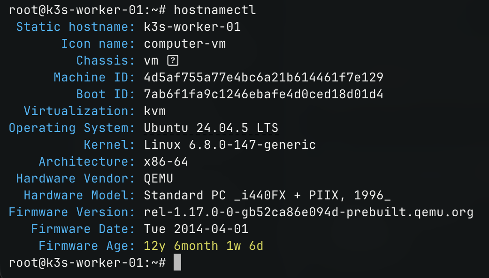
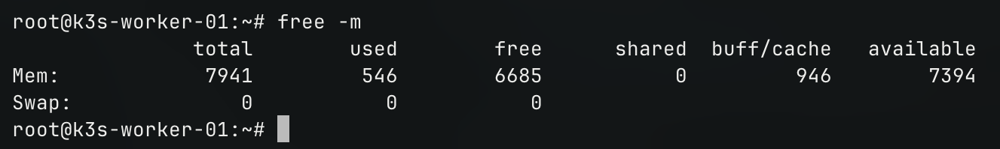
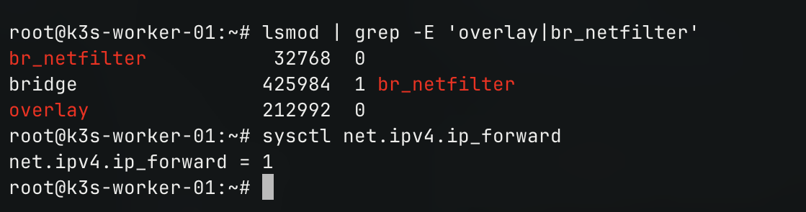

# VPS 02 (k3s-worker-01)

- **IP**: 103.110.86.111
- **Hostname:** `k3s-worker-01`
- **Vai trò:** K3s Worker 1, Argo CD, AI ChatOps

---

## 1. Các lệnh cấu hình trên VPS 02
```bash
# Đổi hostname
sudo hostnamectl set-hostname k3s-worker-01
exec bash

# Cập nhật OS & Cài gói công cụ
sudo apt update && sudo apt upgrade -y
sudo apt install -y curl wget git jq vim iptables socat conntrack iproute2 net-tools wireguard wireguard-tools

# Tắt Swap
sudo swapoff -a
sudo sed -i '/ swap / s/^\(.*\)$/#\1/g' /etc/fstab

# Nạp Kernel Modules & Sysctl
cat <<EOF | sudo tee /etc/modules-load.d/k8s.conf
overlay
br_netfilter
EOF
sudo modprobe overlay
sudo modprobe br_netfilter

cat <<EOF | sudo tee /etc/sysctl.d/k8s.conf
net.bridge.bridge-nf-call-iptables = 1
net.bridge.bridge-nf-call-ip6tables = 1
net.ipv4.ip_forward = 1
EOF
sudo sysctl --system

# Đồng bộ thời gian Việt Nam
sudo timedatectl set-timezone Asia/Ho_Chi_Minh
sudo timedatectl set-ntp on
```

---

## 2. Kết quả kiểm tra

*Kiểm tra Hostname:*
```bash
hostnamectl
```


*Kiểm tra Swap:*
```bash
free -h
```


*Kiểm tra Kernel Modules & IP Forward:*
```bash
lsmod | grep -E 'overlay|br_netfilter'
sysctl net.ipv4.ip_forward
```
