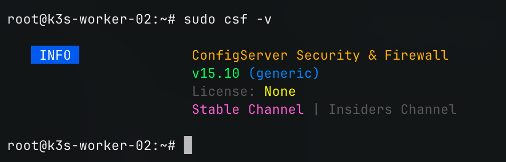
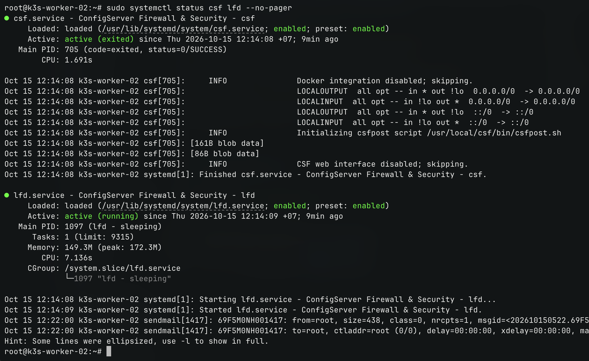

# CẤU HÌNH CSF FIREWALL CHO VPS 03 (k3s-worker-02)

- **IP**: 103.110.86.145
- **Hostname:** `k3s-worker-02`
- **Vai trò:** K3s Worker 2, Prometheus, Grafana
- **IP WireGuard (`wg0`):** `10.10.0.3`

---

## 1. Cài đặt CSF & LFD

```bash
# Cài đặt các gói phụ thuộc
sudo apt update
apt install -y \
wget \
curl \
perl \
libwww-perl \
liblwp-protocol-https-perl \
libgd-perl \
libio-socket-ssl-perl \
libnet-libidn-perl \
libcrypt-ssleay-perl \
libio-socket-inet6-perl \
libsocket6-perl \
libwww-curl-perl \
libjson-perl \
iptables \
ipset \
tar

# Gỡ UFW
sudo ufw status
sudo ufw disable
sudo apt purge -y ufw

# Tải và cài đặt CSF
cd /usr/src
sudo wget https://download.configserver.dev/csf.tgz
sudo tar -xzf csf.tgz
cd csf
sudo sh install.sh

# Kiểm tra tương thích module iptables của kernel VPS
sudo perl /usr/local/csf/bin/csftest.pl

# Khởi động lại CSF
csf -r
systemctl enable lfd
systemctl restart lfd
```

---

## 2. Thiết lập Rules

Cấu hình file `/etc/csf/csf.conf`:
- **Port UDP In:** `51820` (WireGuard VPN Mesh)
- **Bỏ qua interface WireGuard:** `ETH_DEVICE_SKIP = "wg0"`

```bash
# Mở cổng UDP In/Out
sudo sed -i 's/^UDP_IN = .*/UDP_IN = "51820"/' /etc/csf/csf.conf
sudo sed -i '/^UDP_OUT = /s/"$/,51820"/' /etc/csf/csf.conf

# Bỏ qua kiểm tra card mạng ảo WireGuard
sudo sed -i 's/^ETH_DEVICE_SKIP = .*/ETH_DEVICE_SKIP = "wg0"/' /etc/csf/csf.conf

# Whitelist dải IP WireGuard nội bộ
echo "10.10.0.0/24" | sudo tee -a /etc/csf/csf.allow

# Tắt chế độ TESTING để kích hoạt Firewall thực sự
sudo sed -i 's/^TESTING = .*/TESTING = "0"/' /etc/csf/csf.conf

# Khởi động lại CSF và LFD
sudo csf -r
sudo systemctl enable --now csf lfd
```

---

## 3. Lệnh kiểm tra

```bash
# Phiên bản và trạng thái CSF
sudo csf -v

# Trạng thái CSF và LFD
sudo systemctl status csf lfd --no-pager
```

