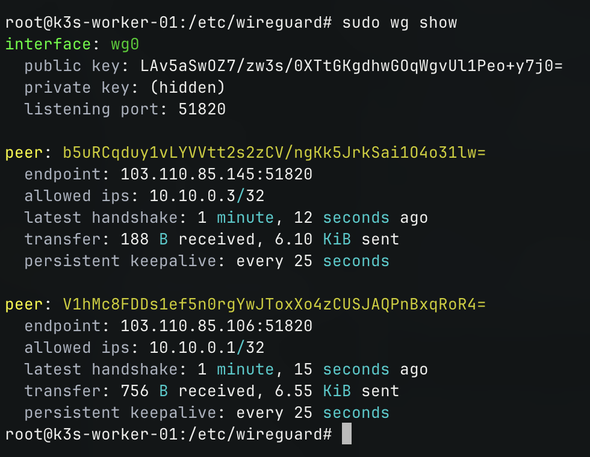
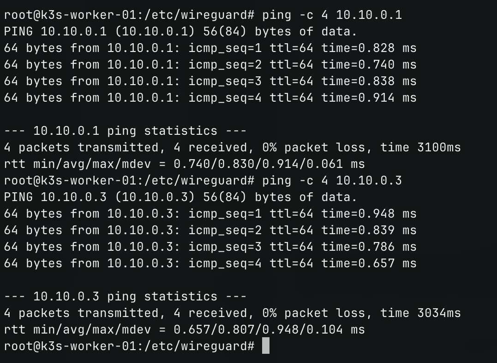

# CẤU HÌNH, KẾT NỐI WIREGUARD VPN CHO VPS 02 (k3s-worker-01)

- **IP**: 103.110.86.111
- **Hostname:** `k3s-worker-01`
- **IP WireGuard (`wg0`):** `10.10.0.2/24`
- **Port UDP lắng nghe:** `51820`

---

## 1. Cài đặt và tạo cặp khóa trên VPS 02
```bash
sudo apt update && sudo apt install -y wireguard wireguard-tools
cd /etc/wireguard
umask 077
wg genkey | tee privatekey | wg pubkey > publickey

# Xem key:
cat privatekey
cat publickey
```

---

## 2. File cấu hình `/etc/wireguard/wg0.conf`
Tạo file `/etc/wireguard/wg0.conf`:
```ini
[Interface]
Address = 10.10.0.2/24
ListenPort = 51820
PrivateKey = <PRIVATE_KEY_VPS02>

# Peer: VPS 01 (Master)
[Peer]
PublicKey = <PUBLIC_KEY_VPS01>
AllowedIPs = 10.10.0.1/32
Endpoint = 103.110.85.106:51820
PersistentKeepalive = 25

# Peer: VPS 03 (Worker 2) - P2P Mesh
[Peer]
PublicKey = <PUBLIC_KEY_VPS03>
AllowedIPs = 10.10.0.3/32
Endpoint = 103.110.85.145:51820
PersistentKeepalive = 25
```

---

## 3. Khởi động và Kiểm tra kết nối
```bash
# Kích hoạt service
sudo systemctl enable --now wg-quick@wg0

# Xem trạng thái WireGuard
sudo wg show

# Ping kiểm tra Master và Worker 2
ping -c 4 10.10.0.1
ping -c 4 10.10.0.3
```

