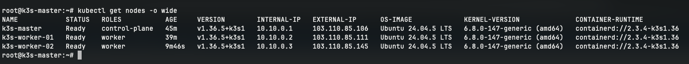
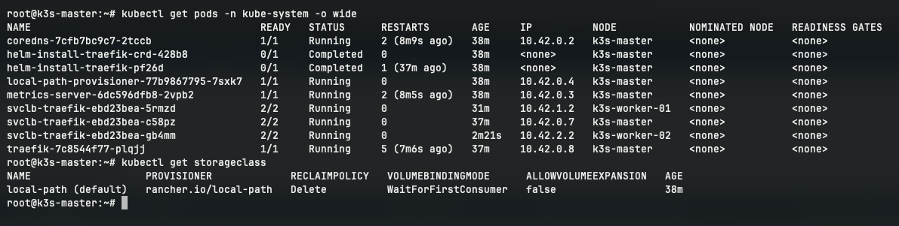
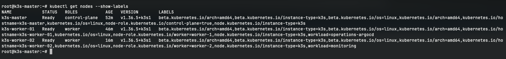
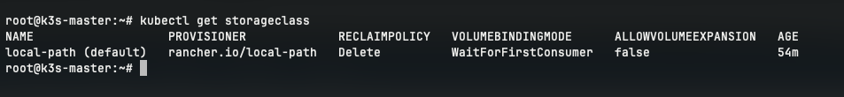
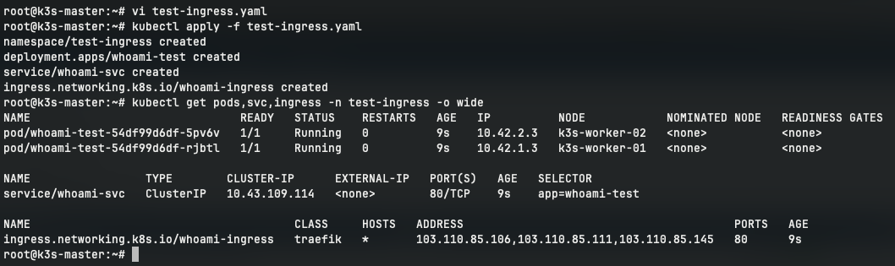
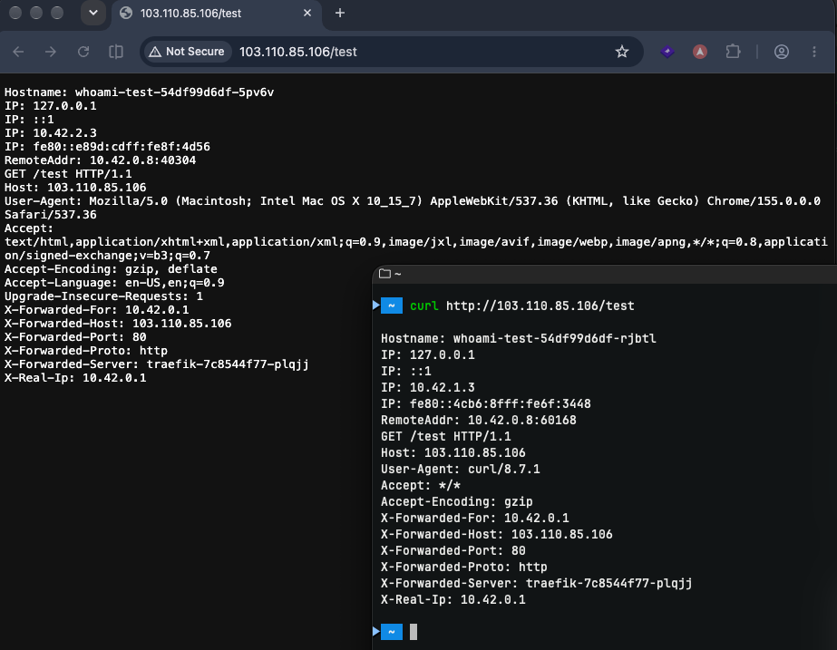
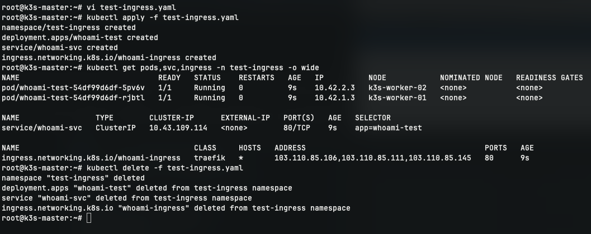

# KIỂM TRA HOẠT ĐỘNG TOÀN CỤM K3S VÀ ĐỊNH TUYẾN INGRESS

## 1. Trạng thái 03 Nodes trong Cluster

**VPS 01 (Master)**:

```bash
kubectl get nodes -o wide
```

Kết quả:
- 3 node đều ở trạng thái `Ready`.
-  `INTERNAL-IP` là các địa chỉ IP WireGuard tương ứng với 3 VPS.
-  `EXTERNAL-IP` là các địa chỉ IP Public tương ứng với 3 VPS



---

## 2. Các Pod hệ thống

```bash
kubectl get pods -n kube-system -o wide
```

Trạng thái các Pod:
- Pod `coredns-7cfb7bc9c7-2tccb` trạng thái `Running`.
- Pod `local-path-provisioner-77b9867795-7sxk7` trạng thái `Running`.
- Pod `traefik-7c8544f77-plqjj` trạng thái `Running` trên node `k3s-master`.
- Pod `svclb-traefik-ebd23bea-...` (K3s Klipper Service Load Balancer) hoạt động sẵn sàng.

---

## 3. Labels & Roles

```bash
kubectl get nodes --show-labels
```

Trạng thái:
- `k3s-worker-01` có các nhãn: `node-role.kubernetes.io/worker=worker-1`, `workload=operations-argocd`.
- `k3s-worker-02` có các nhãn: `node-role.kubernetes.io/worker=worker-2`, `workload=monitoring`.

---

## 4. StorageClass

```bash
kubectl get storageclass
```

Trạng thái 
- StorageClass `local-path` có cờ `(default)`.


---

## 5. Định tuyến Traefik Ingress Controller

Dùng file manifest kiểm thử `test-ingress.yaml`:

```bash
# Triển khai workload và Ingress kiểm thử
kubectl apply -f test-ingress.yaml

# Kiểm tra trạng thái Pods và Ingress
kubectl get pods,svc,ingress -n test-ingress -o wide
```


Kiểm tra truy cập HTTP từ máy tính cá nhân và curl:

```bash
curl http://103.110.85.106/test
```

Kết quả: Trả về thông tin header và IP của Pod `whoami` đang xử lý request.


Dọn dẹp tài nguyên test sau khi kiểm thử:
```bash
kubectl delete -f test-ingress.yaml
```
