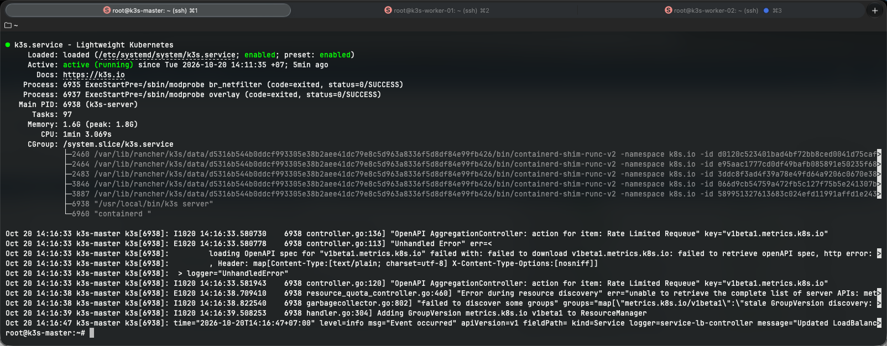
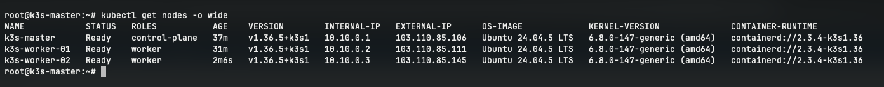
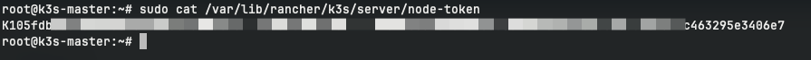

# CÀI ĐẶT VÀ CẤU HÌNH K3S MASTER TRÊN VPS 01 (k3s-master)

- **IP Public**: `103.110.85.106`
- **Hostname**: `k3s-master`
- **IP WireGuard (`wg0`)**: `10.10.0.1/24`
- **Vai trò**: Kubernetes Control Plane (Master), Ingress Controller (Traefik)

---

## 1. Cài đặt K3s Control Plane

```bash
curl -sfL https://get.k3s.io | sh -s - server \
  --node-ip=10.10.0.1 \
  --advertise-address=10.10.0.1 \
  --node-external-ip=103.110.85.106 \
  --flannel-iface=wg0 \
  --tls-san=10.10.0.1 \
  --tls-san=103.110.85.106 \
  --write-kubeconfig-mode=644
```

### Tham số cấu hình:
- `--node-ip=10.10.0.1`: IP nội bộ của Master trong cụm.
- `--advertise-address=10.10.0.1`: IP API Server cho các worker node kết nối qua WireGuard.
- `--node-external-ip=103.110.85.106`: IP Public của VPS 01 cho Ingress và định tuyến ngoài.
- `--flannel-iface=wg0`: Flannel chuyển tiếp các gói tin giữa các Pod qua giao diện mã hóa `wg0`.
- `--tls-san`: Bổ sung IP WireGuard và IP Public vào chứng chỉ SSL của K3s API Server.
- `--write-kubeconfig-mode=644`: Cho phép đọc file `/etc/rancher/k3s/k3s.yaml`.

### Thêm 'cni+,flannel+' vào file cấu hình /etc/csf/csf.conf
```bash
ETH_DEVICE_SKIP = "wg0,cni+,flannel+"
```
---

## 2. Kiểm tra dịch vụ K3s Server

```bash
# Kiểm tra trạng thái dịch vụ systemd
sudo systemctl status k3s

# Thiết lập alias cho kubectl
echo 'alias k=kubectl' >> ~/.bashrc
source ~/.bashrc

# Kiểm tra trạng thái node Master
kubectl get nodes -o wide
```




---

## 3. Lấy Node Token hỗ trợ kết nối các Worker Node

```bash
sudo cat /var/lib/rancher/k3s/server/node-token
```


---

## 4. Kiểm tra các thành phần mặc định trên Master

```bash
# Kiểm tra các Pod hệ thống trong kube-system
kubectl get pods -n kube-system -o wide

# Kiểm tra StorageClass mặc định
kubectl get storageclass
```
