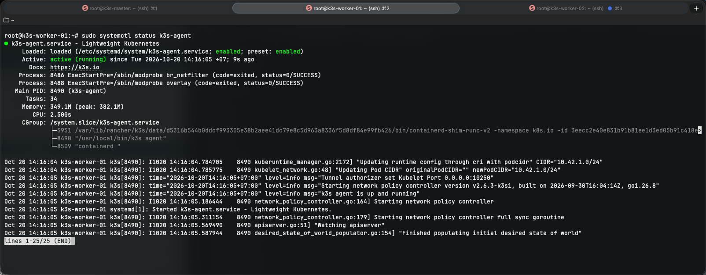
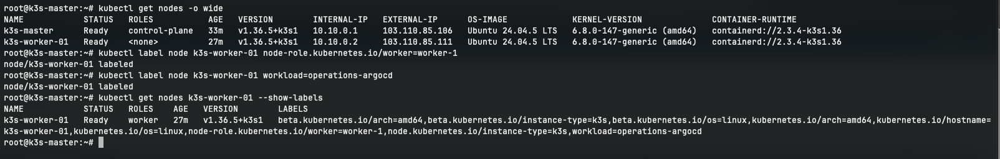

# CÀI ĐẶT VÀ CẤU HÌNH K3S AGENT TRÊN VPS 02 (k3s-worker-01)

- **IP Public**: `103.110.85.111`
- **Hostname**: `k3s-worker-01`
- **IP WireGuard (`wg0`)**: `10.10.0.2/24`
- **Vai trò**: Kubernetes Worker 1 ( GitOps Argo CD, AI ChatOps Agent và App Replica 1)

---

## 1. Cài đặt K3s Agent kết nối vào cụm

```bash
# Thay <K3S_TOKEN> bằng token lấy từ VPS 01 (/var/lib/rancher/k3s/server/node-token)
curl -sfL https://get.k3s.io | K3S_URL=https://10.10.0.1:6443 K3S_TOKEN=<K3S_TOKEN> sh -s - agent \
  --node-ip=10.10.0.2 \
  --node-external-ip=103.110.85.111 \
  --flannel-iface=wg0
```

### Tham số cấu hình:
- `K3S_URL=https://10.10.0.1:6443`: Trỏ Master thông qua VPN WireGuard.
- `--node-ip=10.10.0.2`: IP nội bộ của Worker 1 trong cluster.
- `--node-external-ip=103.110.85.111`: IP Public của Worker 1.
- `--flannel-iface=wg0`: Flannel định tuyến mạng Pod thông qua interface `wg0`.

### Thêm 'cni+,flannel+' vào file cấu hình /etc/csf/csf.conf
```bash
ETH_DEVICE_SKIP = "wg0,cni+,flannel+"
```

---

## 2. Kiểm tra dịch vụ K3s Agent trên VPS 02

```bash
# Kiểm tra dịch vụ agent
sudo systemctl status k3s-agent
```


---

## 3. Gán nhãn cho Worker 1

```bash
# Kiểm tra node
kubectl get nodes -o wide

# Gán vai trò Worker
kubectl label node k3s-worker-01 node-role.kubernetes.io/worker=worker-1

# Gán nhãn Argo CD & AI Agent
kubectl label node k3s-worker-01 workload=operations-argocd

# Kiểm tra lại nhãn đã gán
kubectl get nodes k3s-worker-01 --show-labels
```

