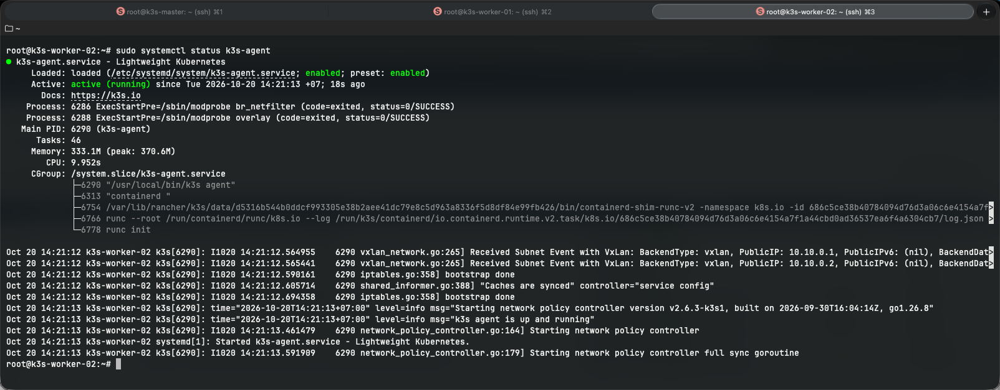
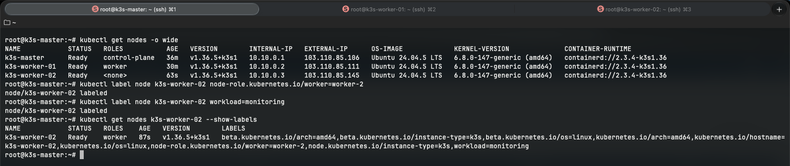

# CÀI ĐẶT VÀ CẤU HÌNH K3S AGENT TRÊN VPS 03 (k3s-worker-02)

- **IP Public**: `103.110.85.145`
- **Hostname**: `k3s-worker-02`
- **IP WireGuard (`wg0`)**: `10.10.0.3/24`
- **Vai trò**: Kubernetes Worker 2 (Chạy ngăn xếp giám sát Prometheus, Grafana và App Replica 2)

---

## 1. Cài đặt K3s Agent kết nối vào cụm

```bash
# Thay <K3S_TOKEN> bằng token lấy từ VPS 01 (/var/lib/rancher/k3s/server/node-token)
curl -sfL https://get.k3s.io | K3S_URL=https://10.10.0.1:6443 K3S_TOKEN=<K3S_TOKEN> sh -s - agent \
  --node-ip=10.10.0.3 \
  --node-external-ip=103.110.85.145 \
  --flannel-iface=wg0
```

### Tham số cấu hình:
- `K3S_URL=https://10.10.0.1:6443`: Kết nối an toàn trực tiếp đến Master qua mạng riêng ảo WireGuard.
- `--node-ip=10.10.0.3`: Khai báo IP WireGuard của Worker 2 cho cụm.
- `--node-external-ip=103.110.85.145`: IP Public của Worker 2.
- `--flannel-iface=wg0`: Định tuyến lưu lượng Pod qua card mạng mã hóa `wg0`.

---

## 2. Kiểm tra dịch vụ K3s Agent trên VPS 03

```bash
# Kiểm tra dịch vụ agent
sudo systemctl status k3s-agent
```


---

## 3. Gán nhãn cho Worker 2

```bash
# Kiểm tra node
kubectl get nodes -o wide

# Gán vai trò Worker
kubectl label node k3s-worker-02 node-role.kubernetes.io/worker=worker-2

# Gán nhãn Monitoring
kubectl label node k3s-worker-02 workload=monitoring

# Kiểm tra lại nhãn đã gán
kubectl get nodes k3s-worker-02 --show-labels
```

