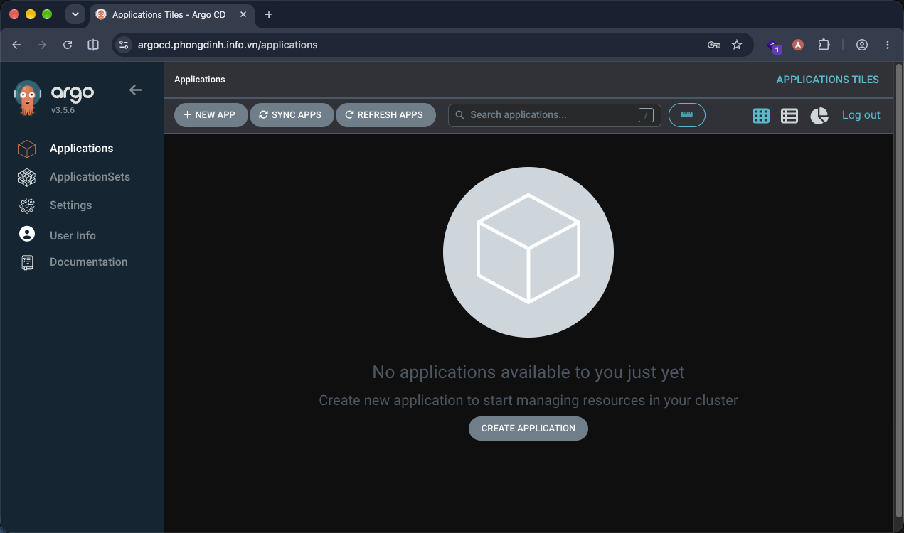
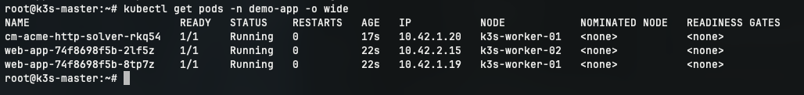
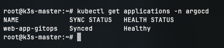
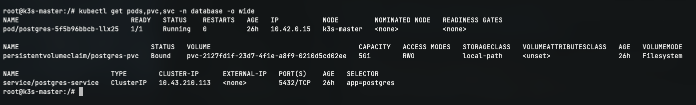
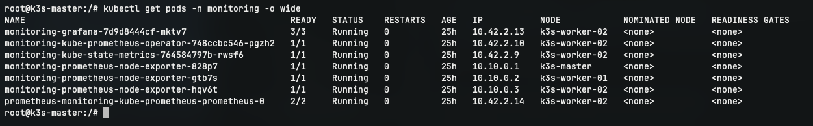

# KIỂM TRA HOẠT ĐỘNG ARGO CD GITOPS VÀ ĐỊNH TUYẾN WEB UI

Tài liệu này tổng hợp các bước kiểm thử, lệnh xác minh và kết quả vận hành của ngăn xếp Argo CD GitOps trên cụm K3s 3-node.

---

## 1. Trạng thái các Pod của Argo CD trên Worker 1

Thực hiện kiểm tra trên **VPS 01 (Master)**:

```bash
kubectl get pods -n argocd -o wide
```

### Kết quả:
- Tất cả các Pod thành phần của Argo CD đều ở trạng thái `Running` (`1/1 Ready`).
- Cột `NODE` hiển thị chính xác **`k3s-worker-01`** (đúng theo phân vùng `workload=operations-argocd`):
  - `argocd-server-...`
  - `argocd-repo-server-...`
  - `argocd-application-controller-0`
  - `argocd-redis-...`
  - `argocd-dex-server-...`
  - `argocd-notifications-controller-...`


---

## 2. Kiểm tra Services và Ingress của Argo CD

Kiểm tra service và tài nguyên Ingress:

```bash
# Kiểm tra services trong namespace argocd
kubectl get svc -n argocd

# Kiểm tra Ingress Traefik của Argo CD
kubectl get ingress -n argocd -o wide
```

### Kết quả:
- Ingress `argocd-server-ingress` nhận host `argocd.phongdinh.info.vn`, trỏ vào backend service `argocd-server:80`.
- Cột `PORTS` hiển thị: **`80, 443`** (sẵn sàng tiếp nhận cả lưu lượng HTTP và HTTPS có chứng chỉ SSL).
- Cột `ADDRESS` hiển thị IP Public của cả 3 node (`103.110.85.106, 103.110.85.111, 103.110.85.145`) do bộ cân bằng tải K3s Klipper Load Balancer mở cổng trên toàn cụm. Trong đó, Master `103.110.85.106` là địa chỉ IP chính tiếp nhận lưu lượng Ingress từ DNS tên miền.


---

## 3. Kiểm tra truy cập Giao diện Quản trị

### 3.1. Truy cập qua trình duyệt
Truy cập địa chỉ: `https://argocd.phongdinh.info.vn`

- Đăng nhập với tài khoản `admin` và mật khẩu lấy từ Secret `argocd-initial-admin-secret`.
- Giao diện Dashboard hiển thị đầy đủ thông tin cluster, danh sách Application và trạng thái kết nối.




---

## 4. Kiểm tra kết nối GitOps Repository và Đồng bộ Ứng dụng

Triển khai thử nghiệm manifest ứng dụng mẫu và Application CRD:

```bash
# 1. Tạo file sample-app.yaml
vi sample-app.yaml

# 2. Triển khai ứng dụng mẫu
kubectl apply -f sample-app.yaml

# 3. Kiểm tra phân bổ replica của Web App
kubectl get pods -n demo-app -o wide
```

### Kết quả:
- 01 replica chạy trên `k3s-worker-01`.
- 01 replica chạy trên `k3s-worker-02` (do chính sách `podAntiAffinity` mềm đã thiết lập).



```bash
# 4. Tạo file application-web-app.yaml
vi application-web-app.yaml

# 5. Áp dụng khai báo Application CRD cho Argo CD
kubectl apply -f application-web-app.yaml

# 6. Kiểm tra trạng thái đồng bộ trên Argo CD CLI / Kubectl
kubectl get applications -n argocd
```

### Kết quả:
- Application `web-app-gitops` có trạng thái:
  - `SYNC STATUS`: `Synced`
  - `HEALTH STATUS`: `Healthy`



### 4.3. Kiểm tra Ingress và Truy cập Ứng dụng Web mẫu qua HTTPS

```bash
# 1. Kiểm tra Ingress của Web App trong namespace demo-app
kubectl get ingress -n demo-app -o wide

# 2. Kiểm tra trạng thái cấp chứng chỉ SSL cho web-app
kubectl get certificate -n demo-app
```

### Kết quả:
- Ingress `web-app-ingress` nhận host `app.phongdinh.info.vn`, `PORTS` hiển thị **`80, 443`**.
- Certificate `web-app-tls-secret` đạt `READY = True`.
- Truy cập web: **`https://app.phongdinh.info.vn`** kiểm tra HTTPS:
  - Giao diện web hiển thị thông tin máy chủ: `Server address`, `Server name: web-app-...`.
  - Khi ấn tải lại trang (**F5**), lưu lượng được Ingress Traefik cân bằng tải luân phiên giữa 2 Pod chạy trên Worker 1 và Worker 2.


---

## 5. Kiểm tra Database PostgreSQL trên Master (VPS 01)

```bash
# Kiểm tra Pod, PVC và Service trong namespace database
kubectl get pods,pvc,svc -n database -o wide
```

### Kết quả mong muốn:
- Pod `postgres-5f5b96bbcb-llx25` ở trạng thái `Running` (`1/1 Ready`) và chạy trên node **`k3s-master`**.
- PersistentVolumeClaim `postgres-pvc` ở trạng thái `Bound` qua storageClass `local-path`.
- Service `postgres-service` sẵn sàng ở port `5432/TCP`.



---

## 6. Kiểm tra Giám sát Prometheus & Grafana trên Worker 2 (VPS 03)

```bash
# 1. Kiểm tra Pods phân bổ đúng trên k3s-worker-02
kubectl get pods -n monitoring -o wide

# 2. Kiểm tra Ingress của Grafana
kubectl get ingress -n monitoring -o wide
```

### Kết quả:
- Các Pod `prometheus-monitoring-...`, `monitoring-grafana-...`, `monitoring-kube-state-metrics-...` đều chạy ổn định trên **`k3s-worker-02`**.
- Ingress `grafana-ingress` mở cổng `80, 443` sẵn sàng tiếp nhận truy cập.
- Truy cập Grafana Dashboard qua tên miền chính thức: `https://grafana.phongdinh.info.vn` (User: `admin`, Pass: `mat-khau!`).

