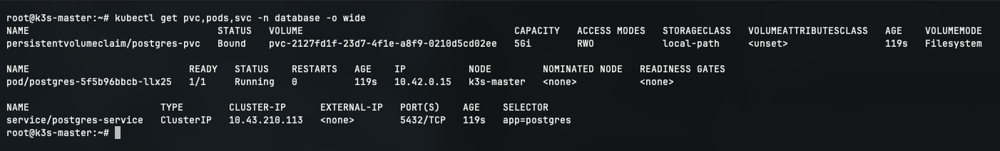
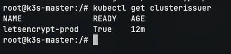
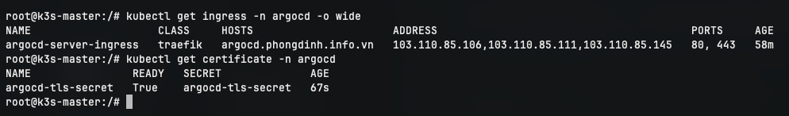
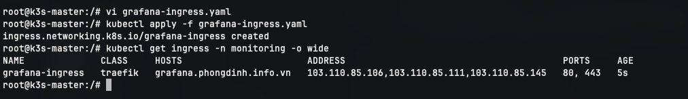
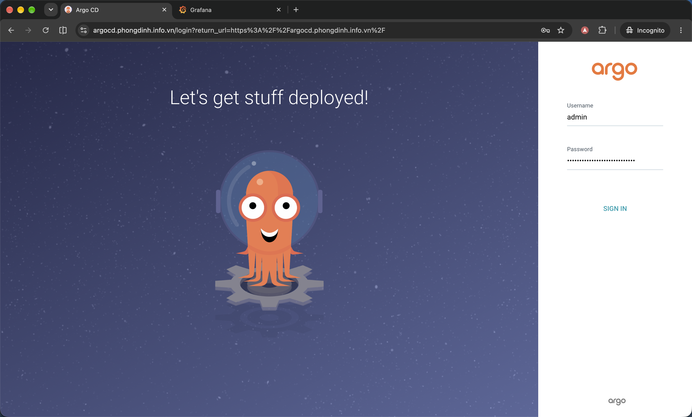
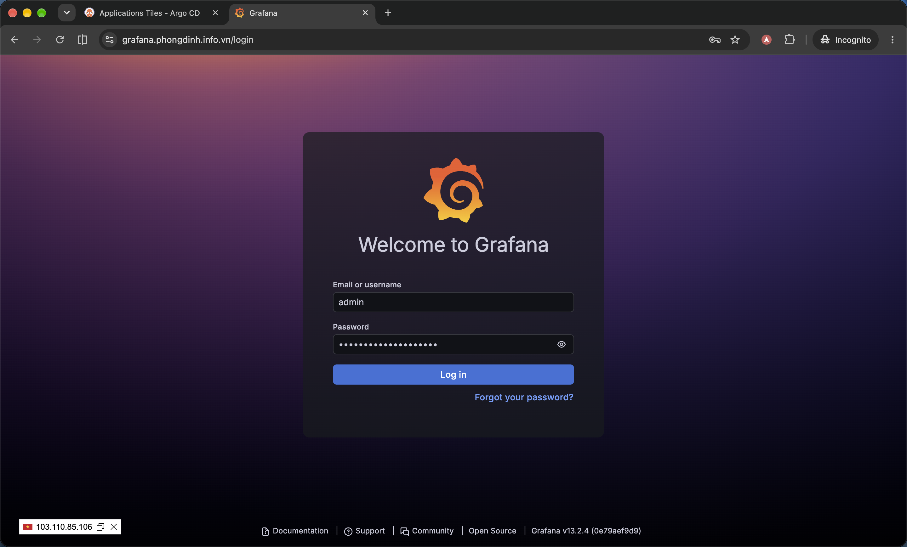
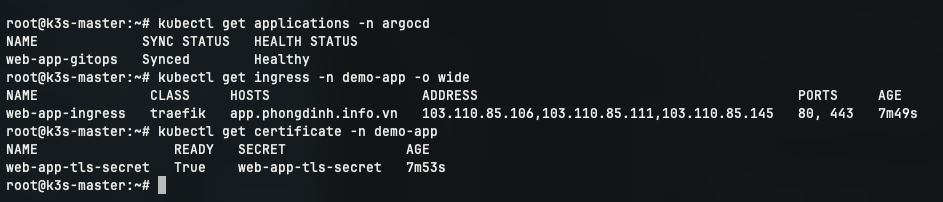
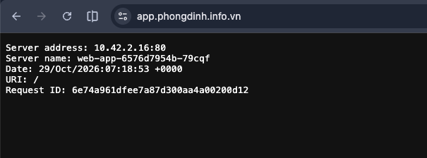

# CẤU HÌNH DATABASE, CERT-MANAGER VÀ TRAEFIK INGRESS TRÊN VPS 01 (k3s-master)

- **IP Public VPS 01**: `103.110.85.106`
- **Hostname**: `k3s-master`
- **IP WireGuard (`wg0`)**: `10.10.0.1/24`
- **Vai trò**: Kubernetes Control Plane (Master), Ingress Controller (Traefik), Database Server (PostgreSQL)

---

## 1. Triển khai Cơ sở dữ liệu PostgreSQL trên Master

Cơ sở dữ liệu PostgreSQL chạy trên `k3s-master` và sử dụng `local-path` PersistentVolume của K3s:

```bash
# 1. Tạo file postgres-deployment.yaml
vi postgres-deployment.yaml

# 2. Triển khai manifest PostgreSQL (Namespace, Secret, PVC 5Gi, Deployment, Service)
kubectl apply -f postgres-deployment.yaml

# 3. Kiểm tra trạng thái PersistentVolumeClaim và Pod trong namespace database
kubectl get pvc,pods,svc -n database -o wide
```

### Kết quả:
- `postgres-pvc` có trạng thái: `STATUS = Bound` với `STORAGECLASS = local-path`.
- Pod `postgres-...` có trạng thái `Running` (`1/1 Ready`), `NODE` là **`k3s-master`**.
- Service `postgres-service` mở cổng `5432/TCP` nội bộ cụm.



---

## 2. Cài đặt Cert-Manager và Cấu hình Let's Encrypt SSL tự động

```bash
# 1. Cài đặt Cert-Manager chính thức trên K3s Master
kubectl apply -f https://github.com/cert-manager/cert-manager/releases/download/v1.16.1/cert-manager.yaml

# 2. Ghim cert-manager-webhook chạy trên Master (tránh lỗi 502 Bad Gateway khi API Server gọi webhook cross-node)
kubectl patch deployment cert-manager-webhook -n cert-manager -p '{"spec":{"template":{"spec":{"nodeSelector":{"kubernetes.io/hostname":"k3s-master"}}}}}'

# 3. Tạo file letsencrypt-issuer.yaml
vi letsencrypt-issuer.yaml

# 4. Áp dụng ClusterIssuer Let's Encrypt Production
kubectl apply -f letsencrypt-issuer.yaml

# 5. Kiểm tra trạng thái ClusterIssuer
kubectl get clusterissuer
```

### Kết quả:
- `letsencrypt-prod` có trạng thái `READY = True`.



---

## 3. Cấu hình Ingress Traefik và SSL cho Argo CD (Đã cấu hình Argo CD trên VPS 02)

Cấu hình Ingress để mở cả cổng HTTP (80) và HTTPS (443):

```bash
# 1. Tạo hoặc cập nhật file argocd-ingress.yaml
vi argocd-ingress.yaml

# 2. Triển khai manifest Ingress cho Argo CD
kubectl apply -f argocd-ingress.yaml

# 3. Kiểm tra Ingress
kubectl get ingress -n argocd -o wide

# 4. Kiểm tra trạng thái cấp chứng chỉ SSL
kubectl get certificate -n argocd
```

### Kết quả:
- Ingress `argocd-server-ingress` nhận host `argocd.phongdinh.info.vn`, trỏ vào service `argocd-server:80`.
- Cột `PORTS` hiển thị: **`80, 443`**.
- Cột `ADDRESS` hiển thị IP Public của cả 3 node trong cụm (`103.110.85.106, 103.110.85.111, 103.110.85.145`).
- Certificate `argocd-tls-secret` đạt trạng thái `READY = True`.



---

## 4. Cấu hình Ingress Traefik và SSL cho Grafana Dashboard (Đã cấu hình trên VPS 03)

```bash
# 1. Tạo file grafana-ingress.yaml
vi grafana-ingress.yaml

# 2. Triển khai manifest Ingress cho Grafana
kubectl apply -f grafana-ingress.yaml

# 3. Kiểm tra Ingress
kubectl get ingress -n monitoring -o wide

# 4. Kiểm tra trạng thái cấp chứng chỉ SSL
kubectl get certificate -n monitoring
```

### Kết quả:
- Ingress `grafana-ingress` nhận host `grafana.phongdinh.info.vn`, trỏ vào service `monitoring-grafana:80`.
- Cột `PORTS` hiển thị: **`80, 443`**.
- Certificate `grafana-tls-secret` đạt trạng thái `READY = True`.



---

## 5. Kiểm tra Truy cập Giao diện Quản trị qua HTTPS

1. **Argo CD Web UI**: `https://argocd.phongdinh.info.vn`
   - Giao diện có ổ khóa xanh HTTPS bảo mật.
   - Tài khoản: `admin`
   - Mật khẩu: Lấy từ Secret `argocd-initial-admin-secret`



2. **Grafana Dashboard**: `https://grafana.phongdinh.info.vn`
   - Giao diện có ổ khóa xanh HTTPS bảo mật.
   - Tài khoản: `admin`
   - Mật khẩu: `Mat-khau!`




3. **Ứng dụng Web mẫu**: `https://app.phongdinh.info.vn`



