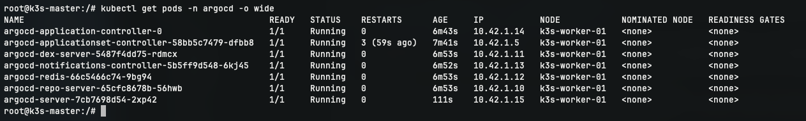
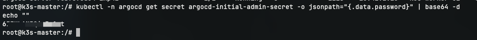

# CÀI ĐẶT VÀ CẤU HÌNH ARGO CD TRÊN VPS 02 (k3s-worker-01)

- **IP Public VPS 02**: `103.110.85.111`
- **Hostname**: `k3s-worker-01`
- **IP WireGuard (`wg0`)**: `10.10.0.2/24`
- **Vai trò**: Kubernetes Worker 1 (Vận hành bộ điều phối GitOps Argo CD, AI ChatOps Agent và App Replica 1)
- **NodeSelector Tag**: `workload=operations-argocd`

---

## 1. Khởi tạo Namespace và Cài đặt Argo CD

Lệnh triển khai được thực hiện từ máy chủ điều khiển **VPS 01 (Master)**:

```bash
# 1. Tạo namespace cho Argo CD
kubectl create namespace argocd

# 2. Cài đặt phiên bản chính thức (stable) của Argo CD
kubectl apply -n argocd -f https://raw.githubusercontent.com/argoproj/argo-cd/stable/manifests/install.yaml
```

---

## 2. Ghim các thành phần Argo CD chạy cố định trên VPS 02

Cập nhật `nodeSelector` cho Deployment và StatefulSet trong namespace `argocd`:

```bash
# Các Deployment của Argo CD sang Worker 1 (workload: operations-argocd)
for deploy in argocd-server argocd-repo-server argocd-dex-server argocd-redis argocd-notifications-controller; do
  kubectl patch deployment $deploy -n argocd -p '{"spec":{"template":{"spec":{"nodeSelector":{"workload":"operations-argocd"}}}}}'
done

# StatefulSet Application Controller sang Worker 1
kubectl patch statefulset argocd-application-controller -n argocd -p '{"spec":{"template":{"spec":{"nodeSelector":{"workload":"operations-argocd"}}}}}'
```

---

## 3. Cấu hình chế độ Insecure cho Argo CD Server

Do Ingress Traefik (chạy trên Master `103.110.85.106`) chịu trách nhiệm nhận traffic từ bên ngoài và chuyển tiếp vào service `argocd-server:80`, cấu hình `argocd-server` chạy ở chế độ HTTP nội bộ để ngăn ngừa lỗi vòng lặp chuyển hướng HTTPS (SSL handshake loop).

```bash
# 1. Bật cấu hình server.insecure = true trong ConfigMap của Argo CD
kubectl patch configmap argocd-cmd-params-cm -n argocd --type merge -p '{"data":{"server.insecure":"true"}}'

# 2. Khởi động lại deployment argocd-server để áp dụng cấu hình
kubectl rollout restart deployment argocd-server -n argocd
```

---

## 4. Kiểm tra vị trí phân bổ Pods của Argo CD

Đảm bảo tất cả Pod thuộc namespace `argocd` đều được gán đúng vào node `k3s-worker-01`:

```bash
kubectl get pods -n argocd -o wide
```

### Kết quả:
- Các Pod: `argocd-server-...`, `argocd-repo-server-...`, `argocd-application-controller-0`, `argocd-redis-...`, `argocd-dex-server-...` có trạng thái `Running` (`1/1`).
- `NODE` hiển thị chính xác: **`k3s-worker-01`**.



---

## 5. Lấy mật khẩu khởi tạo tài khoản quản trị (admin)

Mật khẩu ban đầu tài khoản `admin` được Kubernetes mã hóa tự động trong Secret `argocd-initial-admin-secret`:

```bash
# Giải mã chuỗi mật khẩu admin
kubectl -n argocd get secret argocd-initial-admin-secret -o jsonpath="{.data.password}" | base64 -d
echo ""
```

Thông tin đăng nhập mặc định:
- **Username**: `admin`
- **Password**: Mật khẩu vừa giải mã.



Đăng nhập thành công và đổi mật khẩu mới trong phần cài đặt tài khoản, xóa secret khởi tạo:

```bash
# Xóa secret khởi tạo sau khi đã đổi mật khẩu
kubectl -n argocd delete secret argocd-initial-admin-secret
```
