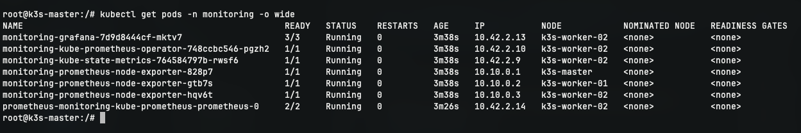
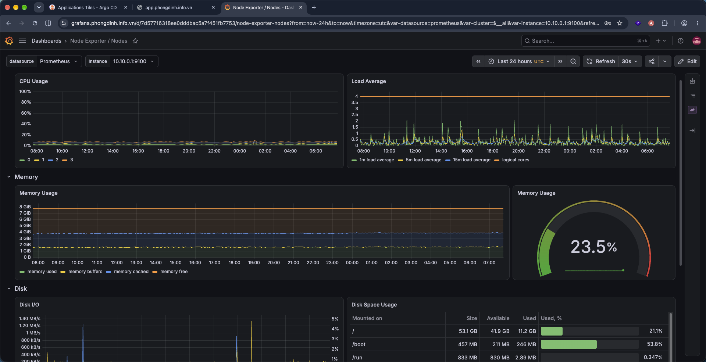
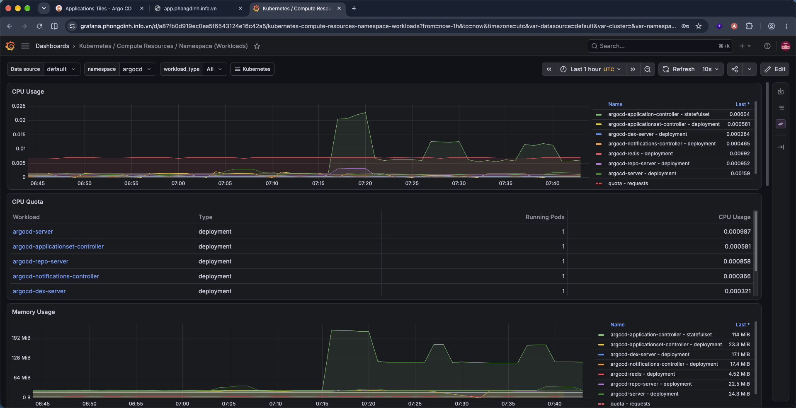

# CÀI ĐẶT VÀ CẤU HÌNH PROMETHEUS & GRAFANA TRÊN VPS 03 (k3s-worker-02)

- **IP Public VPS 03**: `103.110.85.145`
- **Hostname**: `k3s-worker-02`
- **IP WireGuard (`wg0`)**: `10.10.0.3/24`
- **Vai trò**: Kubernetes Worker 2 (Vận hành stack giám sát Prometheus & Grafana, Web App Replica 2)
- **NodeSelector Tag**: `workload=monitoring`

---

## 1. Cài đặt Helm 3 trên Master (VPS 01)

Helm được sử dụng làm công cụ đóng gói và cài đặt `kube-prometheus-stack`.

Lệnh triển khai được thực hiện từ máy chủ điều khiển **VPS 01 (Master)**:

```bash
# 1. Tải và cài đặt Helm 3 chính thức
curl -fsSL https://raw.githubusercontent.com/helm/helm/main/scripts/get-helm-3 | bash

# 2. Kiểm tra phiên bản Helm
helm version

# 3. Bổ sung repo Helm của Prometheus Community
helm repo add prometheus-community https://prometheus-community.github.io/helm-charts
helm repo update

# 4. Cấu hình KUBECONFIG để Helm nhận diện cụm K3s
export KUBECONFIG=/etc/rancher/k3s/k3s.yaml
echo 'export KUBECONFIG=/etc/rancher/k3s/k3s.yaml' >> ~/.bashrc
```

---

## 2. Triển khai Kube-Prometheus-Stack bằng Helm


```bash
vi monitoring-values.yaml

helm install monitoring prometheus-community/kube-prometheus-stack \
  --namespace monitoring \
  --create-namespace \
  -f monitoring-values.yaml
```

### Các thông số trong file `monitoring-values.yaml`:
- **`retention: 3d`**: Lưu metrics 3 ngày.
- **`storageClassName: local-path` (10Gi)**: Cấp phát đĩa SSD cục bộ cho Prometheus.
- **`nodeSelector: workload: monitoring`**: Pods của Prometheus, Grafana, Kube-state-metrics chạy trên **`k3s-worker-02`**.
- **`alertmanager.enabled: false`**: Tắt bộ gửi cảnh báo để tiết kiệm RAM.
- **`nodeExporter.enabled: true`**: Chạy dưới dạng DaemonSet trên 3 node để thu thập chỉ số CPU/RAM phục vụ thực nghiệm.

---

## 3. Kiểm tra vị trí phân bổ Pods Giám sát trên Worker 2

Danh sách Pod trong namespace `monitoring`:

```bash
kubectl get pods -n monitoring -o wide
```

### Kết quả:
- Các Pod có trạng thái `Running` (`1/1` hoặc `2/2`) và chạy cố định trên node **`k3s-worker-02`**:
  - `prometheus-monitoring-kube-prometheus-prometheus-0`
  - `monitoring-grafana-...`
  - `monitoring-kube-state-metrics-...`
  - `monitoring-kube-prometheus-operator-...`
- Với `monitoring-prometheus-node-exporter-...` có 3 Pod chạy trên 3 node (`k3s-master`, `k3s-worker-01`, `k3s-worker-02`).



---

## 4. Kiểm tra Dashboard trên Grafana

Truy cập vào `https://grafana.phongdinh.info.vn`
1. **Tài khoản**: `admin`
2. **Mật khẩu**: `Mat-khau!`
3. **Dashboards**:
   - **Node Exporter / Nodes**: Kiểm tra mức tiêu hao CPU, RAM, Network I/O của từng VPS trong 3 máy.
   - **Kubernetes / Compute Resources / Workloads**: Theo dõi mức tiêu thụ tài nguyên của Pod ứng dụng khi chạy tải với `k6`.


