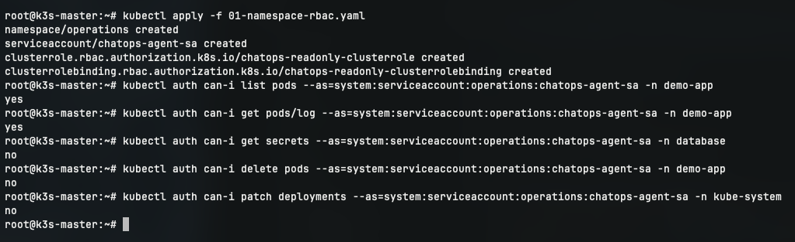
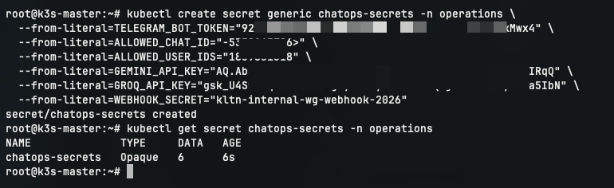

# THIẾT LẬP NAMESPACE, SECRET VÀ PHÂN QUYỀN RBAC PHÂN TẦNG TRÊN VPS 01 (k3s-master)

- **IP Public VPS 01**: `103.110.85.106`
- **Hostname**: `k3s-master`
- **IP WireGuard (`wg0`)**: `10.10.0.1/24`
- **Vai trò**: Control Plane quản lý phân quyền RBAC đặc quyền tối thiểu (Least Privilege) và Kubernetes Secrets cho AI ChatOps Agent.

---

## 1. Chuẩn bị Khóa Xác thực (Telegram, Gemini & Groq Fallback)

- `TELEGRAM_BOT_TOKEN`
- `ALLOWED_CHAT_ID`, `ALLOWED_USER_IDS`
- `GEMINI_API_KEY`
- `GROQ_API_KEY`

---

## 2. Triển khai Phân quyền RBAC

```bash
vi 01-namespace-rbac.yaml

kubectl apply -f 01-namespace-rbac.yaml
```

### Áp dung các nguyên tắc bảo mật RBAC:
- **`ClusterRole` (`chatops-readonly-clusterrole`)**: cấp quyền đọc (`get, list, watch`) trên `nodes`, `pods`, `pods/log`, `events`, `deployments`, `applications.argoproj.io`. **không cấp quyền đọc `secrets`** (ngăn chặn lộ mật khẩu `postgres-secret` hoặc TLS key), không cấp quyền `delete` hay `exec`.
- **`Role` cục bộ (`chatops-demoapp-operator` & `chatops-argocd-refresher`)**: Cô lập quyền `patch` trong phạm vi đúng tên tài nguyên được chỉ định, không cho phép can thiệp `kube-system`, `database` hay `monitoring`.

### Kiểm tra phân quyền bằng `kubectl auth can-i`:

```bash
# 1. Quyền đọc danh sách Pod và Log trong demo-app (Kết quả: yes)
kubectl auth can-i list pods --as=system:serviceaccount:operations:chatops-agent-sa -n demo-app
kubectl auth can-i get pods/log --as=system:serviceaccount:operations:chatops-agent-sa -n demo-app

# 2. Chặn đọc Secrets của Database PostgreSQL (Kết quả: no)
kubectl auth can-i get secrets --as=system:serviceaccount:operations:chatops-agent-sa -n database

# 3. Chặn xóa Pod hoặc can thiệp kube-system (Kết quả: no)
kubectl auth can-i delete pods --as=system:serviceaccount:operations:chatops-agent-sa -n demo-app
kubectl auth can-i patch deployments --as=system:serviceaccount:operations:chatops-agent-sa -n kube-system
```



---

## 3. Tạo Kubernetes Secret Lưu Trữ Khóa API

Tạo trên **VPS 01 (`k3s-master`)**

```bash
kubectl create secret generic chatops-secrets -n operations \
  --from-literal=TELEGRAM_BOT_TOKEN="<TELEGRAM_BOT_TOKEN>" \
  --from-literal=ALLOWED_CHAT_ID="<YOUR_TELEGRAM_CHAT_ID>" \
  --from-literal=ALLOWED_USER_IDS="<TELEGRAM_USER_ID>" \
  --from-literal=GEMINI_API_KEY="<GEMINI_API_KEY>" \
  --from-literal=GROQ_API_KEY="<GROQ_API_KEY>" \
  --from-literal=WEBHOOK_SECRET="kltn-internal-wg-webhook-2026"

kubectl get secret chatops-secrets -n operations
```
