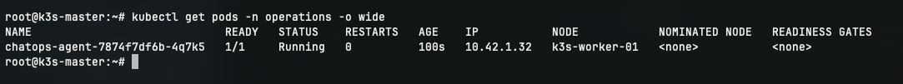

# ĐÓNG GÓI VÀ TRIỂN KHAI LÕI AI CHATOPS AGENT TRÊN VPS 02 (k3s-worker-01)

- **IP Public VPS 02**: `103.110.85.111`
- **Hostname**: `k3s-worker-01`
- **IP WireGuard (`wg0`)**: `10.10.0.2/24`
- **Vai trò**: Vận hành Pod `chatops-agent` trong namespace `operations` (`workload=operations-argocd`), kết nối Telegram qua cơ chế Outbound Async Long-Polling xuyên tường lửa CSF (không mở thêm cổng Inbound nào ra Internet).

---

## 1. Đóng gói Container Image Tối ưu với `uv` trên VPS 02

Mã nguồn Agent `agent_src/` sử dụng **Multi-stage `Dockerfile` và `uv`**, quyền `non-root` (`UID 10001`), `readOnlyRootFilesystem: true`.

Push `agent_src/` lên GitHub.

# Trên VPS 02 (k3s-worker-01)
```bash
# 1. Tạo thư mục /tmp/kltn, kéo repository từ GitHub về 
cd /tmp
mkdir kltn && cd kltn/
git clone https://github.com/phongdh262/kltn-k8s-gitops-ai.git

# 2. Di chuyển vào thư mục agent_src vừa kéo về
cd kltn-k8s-gitops-ai/Ha_tang/cau_hinh/06_AI_ChatOps/agent_src

# 3. Đóng gói Docker Image với multi-stage uv
docker build -t ghcr.io/phongdh262/kltn-chatops-agent:latest .

# 4. Nạp Image trực tiếp vào containerd của K3s trên VPS 02
docker save ghcr.io/phongdh262/kltn-chatops-agent:latest | sudo k3s ctr images import -

# 5. Dọn dẹp thư mục tạm sau khi nạp thành công
rm -rf /tmp/kltn
```

---

## 2. Triển khai Deployment `chatops-agent`

Lệnh được thực hiện từ **VPS 01 (`k3s-master`)**:

```bash
# 1. Triển khai Deployment và Service nội bộ (:8000)
vi 02-chatops-deployment.yaml
kubectl apply -f 02-chatops-deployment.yaml

# 2. Xác nhận Pod Running trên k3s-worker-01
kubectl get pods,svc -n operations -o wide

# 3. Kiểm tra log khởi động của Agent
kubectl logs -n operations -l app=chatops-agent --tail=30
```

### Các thiết kế áp dụng:
- **`replicas: 1` + `strategy: Recreate`**: Ngăn xung đột `409 Conflict`  Telegram khi cập nhật Pod.
- **Soft `nodeAffinity` (`preferredDuringSchedulingIgnoredDuringExecution`)**: Ưu tiên trọng số `100` đặt Pod trên **VPS 02 (`workload=operations-argocd`)**, trọng số dự phòng `50` sang **VPS 03 (`k3s-worker-02`)** nếu VPS 02 gặp sự cố.


