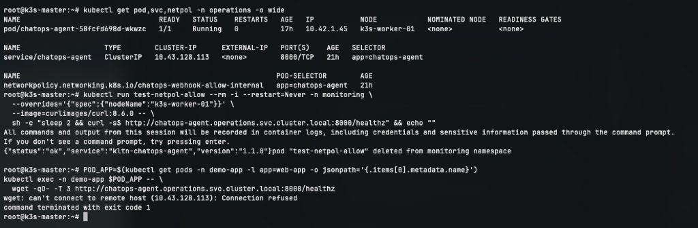
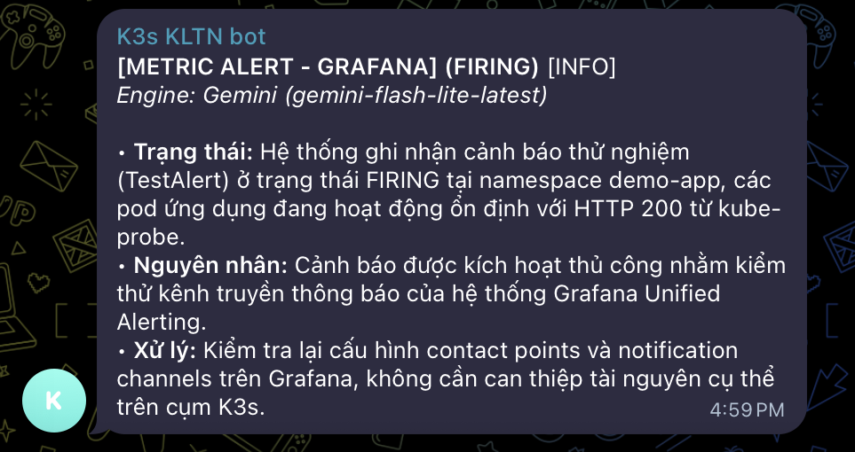
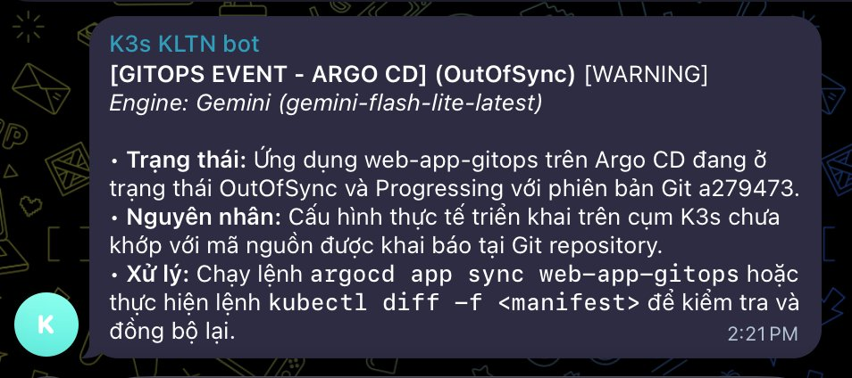
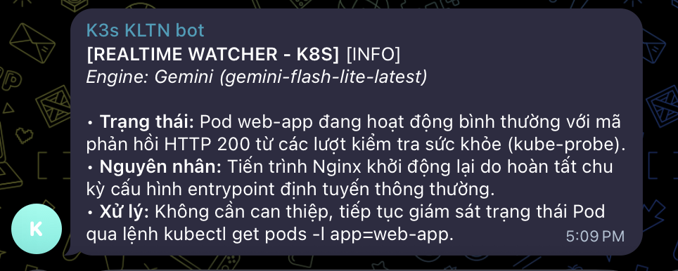

# KIỂM THỬ NETWORK POLICY, CẢNH BÁO CHỦ ĐỘNG GRAFANA / ARGO CD VÀ PROACTIVE WATCHER
---

## 1. Kiểm thử Chính sách Mạng `NetworkPolicy` Khóa Cổng Webhook (`:8000`)

Kiểm chứng `NetworkPolicy` chỉ cho phép kết nối từ `monitoring` và `argocd`, đồng thời chặn kết nối từ các namespace khác:  **VPS 01 (`k3s-master`)**

```bash
# 1. Kiểm tra kết nối hợp lệ từ namespace monitoring (Kết quả: HTTP 200 OK)
kubectl run test-netpol-allow --rm -i --restart=Never -n monitoring \
  --overrides='{"spec":{"nodeName":"k3s-worker-01"}}' \
  --image=curlimages/curl:8.6.0 -- \
  sh -c "sleep 2 && curl -sS http://chatops-agent.operations.svc.cluster.local:8000/healthz" && echo ""

# 2. Kiểm tra chặn kết nối trái phép từ namespace demo-app (Kết quả: Connection refused)
POD_APP=$(kubectl get pods -n demo-app -l app=web-app -o jsonpath='{.items[0].metadata.name}')
kubectl exec -n demo-app $POD_APP -- \
  wget -qO- -T 3 http://chatops-agent.operations.svc.cluster.local:8000/healthz
```

- **Kết quả**:
  - Yêu cầu từ `monitoring` trả về `{"status":"ok","service":"kltn-chatops-agent","version":"1.1.0"}`.
  - Yêu cầu từ `demo-app` bị từ chối kết nối do quy tắc Ingress của `chatops-webhook-allow-internal`.



---

## 2. Kiểm thử Phân biệt Cảnh báo Grafana Unified Alerting và Sự kiện Argo CD Notifications

### 2.1. Cảnh báo Vượt ngưỡng Chỉ số từ Grafana (`/webhooks/grafana`)
1. Kích hoạt gửi cảnh báo từ Contact Point `ai-chatops-webhook` trên Grafana (VPS 03) hoặc gửi gói tin kiểm thử từ namespace `monitoring`.
2. **Kết quả trên Telegram**:
   - Hiển thị tiêu đề phân loại: **`[METRIC ALERT - GRAFANA] (FIRING)`**.
   - Nội dung tập trung vào tên cảnh báo (`alertname`), giá trị PromQL thực tế và khuyến nghị xử lý tài nguyên.



### 2.2. Sự kiện Trạng thái Đồng bộ từ Argo CD (`/webhooks/argocd`)
1. Kích hoạt sự kiện sai lệch đồng bộ cấu hình (`OutOfSync` / `SyncFailed`) từ namespace `argocd`:
   ```bash
   # Tạm tắt auto-sync và thay đổi replicas để tạo trạng thái OutOfSync thực tế
   kubectl patch application web-app-gitops -n argocd --type merge -p '{"spec":{"syncPolicy":null}}'
   kubectl scale deploy web-app -n demo-app --replicas=3

   # Khôi phục lại chế độ tự động đồng bộ (selfHeal + prune) sau khi nhận thông báo
   kubectl patch application web-app-gitops -n argocd --type merge -p '{"spec":{"syncPolicy":{"automated":{"prune":true,"selfHeal":true}}}}'
   ```
2. **Kết quả trên Telegram**:
   - Hiển thị tiêu đề phân loại: **`[GITOPS EVENT - ARGO CD]`**.
   - Nội dung liệt kê **Trạng thái**, **Nguyên nhân** và **Xử lý** kèm mã `Git Revision`.
   - Bộ lọc `should_suppress_duplicate` dựa trên khóa `fingerprint` ngăn chặn việc gửi lặp cùng một sự kiện trong cửa sổ thời gian 90 giây.



---

## 3. Kiểm thử `Proactive K8s Watcher` Phát hiện Sự cố Dưới 5 Giây

1. Trên **VPS 01 (`k3s-master`)**, giả lập sự cố dừng tiến trình chính của container `web-app`:
   ```bash
   POD_NAME=$(kubectl get pods -n demo-app -l app=web-app -o jsonpath='{.items[0].metadata.name}')
   kubectl exec -n demo-app $POD_NAME -- kill 1
   ```
2. **Kết quả trên Telegram**:
   - Phát hiện biến động `Restarts` tăng của container trong chu kỳ quét `< 5 giây`.
   - Trích xuất `[PREVIOUS CRASH LOG]`, K8s Events, chỉ số PromQL và gửi báo cáo **`[REALTIME WATCHER - K8S]`** kèm phân tích nguyên nhân (RCA) về nhóm Telegram.



