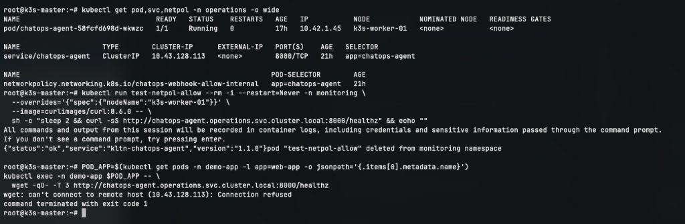

# THIẾT LẬP INTERNAL WEBHOOK SERVICE, NETWORK POLICY VÀ PROACTIVE K8S WATCHER

- **IP Public VPS 01**: `103.110.85.106` (`k3s-master` — `10.10.0.1/24`)
- **IP Public VPS 02**: `103.110.85.111` (`k3s-worker-01` — `10.10.0.2/24`)
- **Vai trò**: Cập nhật Agent (`webhooks.py`, `watcher.py`) trên VPS 02; triển khai Service nội bộ (`:8000`), chính sách mạng `NetworkPolicy` và kích hoạt luồng giám sát chủ động trên VPS 01.

---

## 1. Cập nhật Container Image trên VPS 02 (`k3s-worker-01`)

```bash
cd /tmp
mkdir -p kltn && cd kltn
git clone https://github.com/phongdh262/kltn-k8s-gitops-ai.git
cd kltn-k8s-gitops-ai/Ha_tang/cau_hinh/06_AI_ChatOps/agent_src

docker build -t ghcr.io/phongdh262/kltn-chatops-agent:v1.1 .
docker save ghcr.io/phongdh262/kltn-chatops-agent:v1.1 | sudo k3s ctr images import -
```

---

## 2. Triển khai Service Webhook và `NetworkPolicy` trên VPS 01 (`k3s-master`)

```bash
# 1. Cập nhật khóa xác thực WEBHOOK_SECRET trong Secret chatops-secrets
kubectl patch secret chatops-secrets -n operations --type merge \
  -p '{"stringData":{"WEBHOOK_SECRET":"kltn-internal-wg-webhook-2026"}}'

# 2. Tạo Service ClusterIP cổng 8000
vi 01-webhook-service.yaml
kubectl apply -f 01-webhook-service.yaml

# 3. Áp dụng NetworkPolicy giới hạn truy cập cổng 8000
vi 02-networkpolicy.yaml
kubectl apply -f 02-networkpolicy.yaml

# 4. Cập nhật Deployment chatops-agent mở cổng 8000 và bật Proactive Watcher
vi enable-watcher-patch.yaml
kubectl patch deployment chatops-agent -n operations --patch-file enable-watcher-patch.yaml
kubectl rollout restart deployment chatops-agent -n operations

# 5. Kiểm tra trạng thái Service, NetworkPolicy và Pod
kubectl get pod,svc,netpol -n operations -o wide
```

### Nguyên tắc bảo mật của `NetworkPolicy`:
- Đối tượng áp dụng: Pod có nhãn `app: chatops-agent` trong namespace `operations`.
- Chỉ cho phép lưu lượng TCP vào cổng `8000` từ 2 namespace:
  - `monitoring` (Pod Grafana trên VPS 03 gọi qua giao diện `wg0`).
  - `argocd` (Pod `argocd-notifications-controller` trên VPS 02).
- Từ chối toàn bộ kết nối đến cổng `8000` từ các namespace khác (`default`, `demo-app`, `database`).

