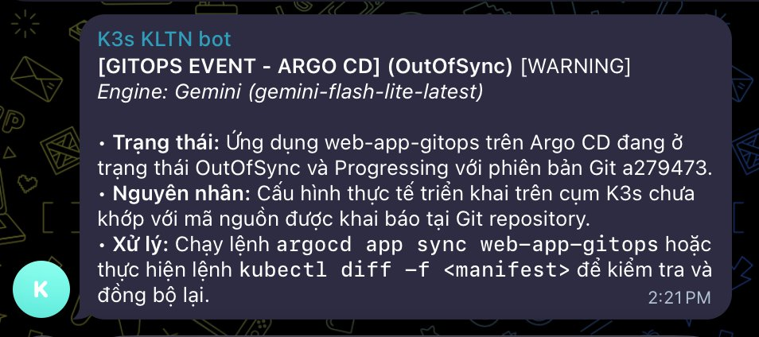

# CẤU HÌNH ARGO CD NOTIFICATIONS ĐẨY SỰ KIỆN ĐỒNG BỘ GITOPS

- **IP Public VPS 02**: `103.110.85.111`
- **Hostname**: `k3s-worker-01` (`workload=operations-argocd`)
- **IP WireGuard (`wg0`)**: `10.10.0.2/24`
- **Vai trò**: Cấu hình `argocd-notifications-controller` gửi sự kiện trạng thái đồng bộ GitOps (`OutOfSync`, `SyncFailed`) sang cổng `/webhooks/argocd` của AI ChatOps Agent.

---

## 1. Phân tách phạm vi sự kiện với Grafana Alerting

- **Argo CD Notifications (`/webhooks/argocd`)**: cấu hình bắt sự kiện  đồng bộ cấu hình GitOps (`trigger.on-sync-failed` và `trigger.on-out-of-sync`), thông tin `Application`, `Sync Status`, `Operation Phase`, mã `Git Revision`. Không cấu hình trigger theo dõi container restart.
- **Grafana Unified Alerting (`/webhooks/grafana`)**: Cấu hình cảnh báo vượt ngưỡng tài nguyên định lượng (PromQL CPU, RAM, Disk, HTTP Latency/Errors).
- **Proactive K8s Watcher (`watcher.py`)**: Cấu hình phát hiện sự cố thực thi tức thời cấp Pod/Node (`< 5s`).

---

## 2. Cấu hình Secret và ConfigMap cho Argo CD Notifications

Thực hiện từ **VPS 01 (`k3s-master`)**:

```bash
# 1. Cấp khóa xác thực webhook-secret cho argocd-notifications-secret
kubectl patch secret argocd-notifications-secret -n argocd --type merge \
  -p '{"stringData":{"webhook-secret":"kltn-internal-wg-webhook-2026"}}'

# 2. Áp dụng ConfigMap argocd-notifications-cm
vi argocd-notifications-cm.yaml
kubectl apply -f argocd-notifications-cm.yaml

# 3. Đăng ký nhận thông báo cho Application web-app-gitops
kubectl annotate app web-app-gitops -n argocd \
  notifications.argoproj.io/subscribe.on-sync-failed.chatops-agent="" \
  notifications.argoproj.io/subscribe.on-out-of-sync.chatops-agent="" \
  --overwrite

# 4. Khởi động lại bộ điều khiển thông báo của Argo CD
kubectl rollout restart deployment argocd-notifications-controller -n argocd
kubectl get pods -n argocd -l app.kubernetes.io/name=argocd-notifications-controller
```


