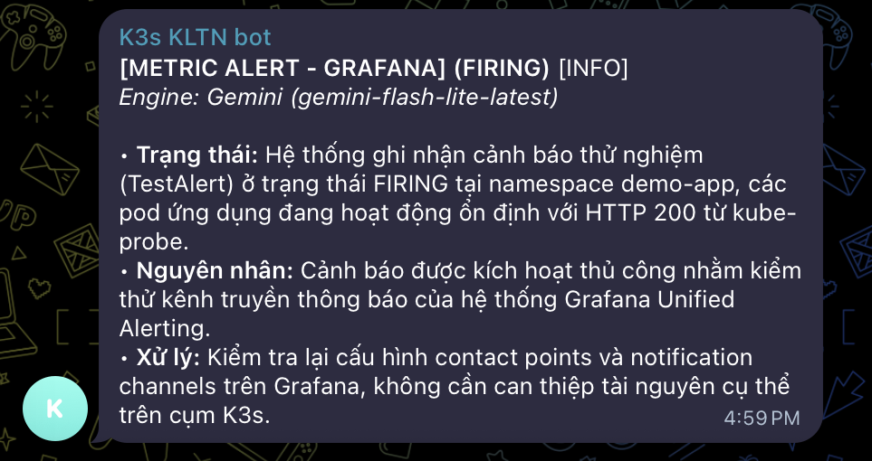

# CẤU HÌNH GRAFANA UNIFIED ALERTING ĐẨY CẢNH BÁO QUA WIREGUARD

- **IP Public VPS 03**: `103.110.85.145`
- **Hostname**: `k3s-worker-02` (`workload=monitoring`)
- **IP WireGuard (`wg0`)**: `10.10.0.3/24`
- **Vai trò**: Sử dụng bộ cảnh báo nội tại của Grafana (`Grafana Unified Alerting`) đẩy cảnh báo vượt ngưỡng tài nguyên từ VPS 03 qua đường hầm `wg0` sang endpoint `/webhooks/grafana` của AI ChatOps Agent trên VPS 02.

---

## 1. Cập nhật Contact Point cho Grafana qua Helm

Thực hiện từ **VPS 01 (`k3s-master`)**:

```bash
# 1. Tạo file cấu hình Contact Point và Notification Policy
vi grafana-contactpoint-values.yaml

# 2. Nâng cấp bản cài đặt kube-prometheus-stack nạp cấu hình Webhook
helm upgrade monitoring prometheus-community/kube-prometheus-stack \
  --namespace monitoring \
  --reuse-values \
  -f grafana-contactpoint-values.yaml

# 3. Khởi động lại Pod Grafana để nạp cấu hình và kiểm tra trạng thái
kubectl rollout restart deploy/monitoring-grafana -n monitoring
kubectl get pods -n monitoring -l app.kubernetes.io/name=grafana -o wide
```

### Thông số kỹ thuật kết nối:
- **Endpoint đích**: `http://chatops-agent.operations.svc.cluster.local:8000/webhooks/grafana`
- **Cơ chế xác thực**: `Authorization: Bearer <WEBHOOK_SECRET>`
- **Nhóm cảnh báo (`group_by`)**: `["alertname", "namespace"]`, thời gian gom nhóm `group_wait: 10s`, chu kỳ lặp `repeat_interval: 30m`.

---

## 2. Kiểm tra Contact Point trên Giao diện Grafana

1. Truy cập `https://grafana.phongdinh.info.vn` $\rightarrow$ **Alerting** $\rightarrow$ **Notification configuration** $\rightarrow$ **Contact points**.
2. Tại mục **`ai-chatops-webhook`**, chọn **View** $\rightarrow$ **Test** $\rightarrow$ **Send test notification** để kiểm tra kết nối từ VPS 03 (`monitoring`) sang VPS 02 (`operations`) qua giao diện `wg0`.


