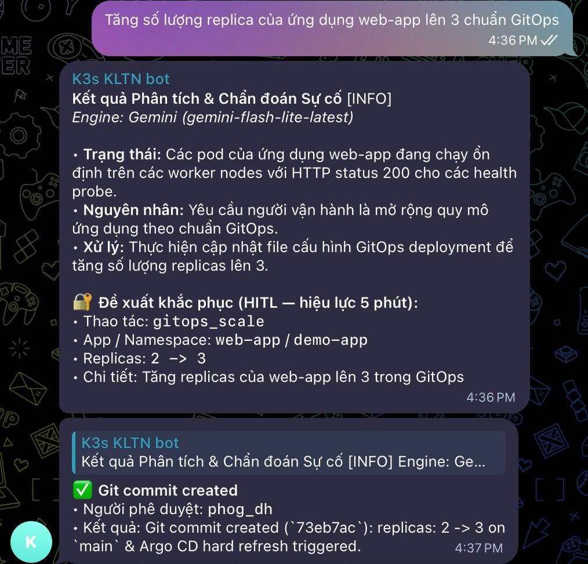
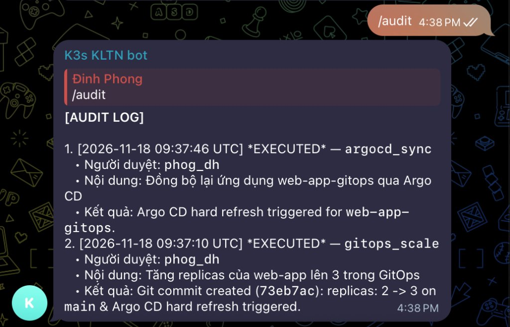

# KIỂM THỬ PHÊ DUYỆT HUMAN-IN-THE-LOOP (HITL) VÀ NHẬT KÝ KIỂM TOÁN

---

## 1. Kiểm thử Luồng Scale Replicas Chuẩn GitOps qua Telegram (`HITL`)

1. Gửi yêu cầu điều chỉnh số lượng replica trên Telegram:
   ```text
   Tăng số lượng replica của ứng dụng web-app lên 3 chuẩn GitOps
   ```
2. **Thông tin đề xuất**:
   - Hiển thị tham số thực thi: ứng dụng (`web-app`), namespace (`demo-app`), số lượng replica (`2 -> 3`), thời hạn TTL `300s` và nút **`[✅ Duyệt]`** / **`[❌ Hủy bỏ]`**.
3. **Thao tác `[✅ Duyệt]`**:
   - Kiểm tra `user_id` thuộc `ALLOWED_USER_IDS` và trạng thái hiệu lực một lần của `action_id`.
   - Cập nhật `spec.replicas: 3` trong `Ha_tang/cau_hinh/05_ArgoCD_GitOps/manifests/web-app.yaml` bằng `ruamel.yaml`, tạo commit qua GitHub API và gắn annotation `Hard Refresh` lên `web-app-gitops`.
   - Argo CD đồng bộ cấu hình từ Git về cụm K3s (`3/3 Running`).



---

## 2. Kiểm tra Nhật ký Kiểm toán (`/audit`)

1. Thực thi lệnh `/audit` trên Telegram.
2. **Kết quả**:
   - Ghi nhận bản ghi trạng thái `EXECUTED` (`gitops_scale`, `argocd_sync`), thời gian (UTC), `Người duyệt`, `Nội dung` và `Kết quả` kèm mã commit.
   - Lọc dữ liệu nhạy cảm trong nội dung nhật ký qua hàm `redact_sensitive_text`.


