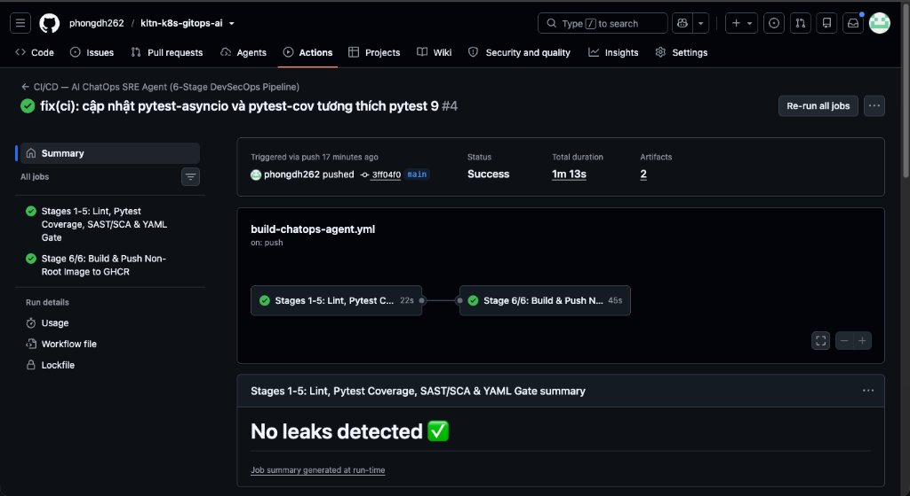

# THIẾT LẬP GITHUB ACTIONS CI/CD 6 GIAI ĐOẠN VÀ GHCR

- **Pipeline**: `.github/workflows/build-chatops-agent.yml`
- **Container Registry**: `ghcr.io/phongdh262/kltn-chatops-agent`
- **Vai trò**: Kiểm tra mã tĩnh, chạy kiểm thử đơn vị (`pytest`), quét lỗ hổng/bí mật, kiểm tra cú pháp YAML và đóng gói image `non-root` đẩy lên GHCR.

---

## 1. Cấu trúc 6 Giai đoạn trong Pipeline CI/CD

Trigger khi có `push` hoặc `pull_request` trên nhánh `main` tại `Ha_tang/cau_hinh/06_AI_ChatOps/**`, `Ha_tang/cau_hinh/07_EventDriven_Alerting_NetPol/manifests/**` hoặc `.github/workflows/build-chatops-agent.yml`:

1. **Stage 1/6 — Static Lint Check**: Chạy `ruff check app tests` kiểm tra chuẩn mã nguồn Python.
2. **Stage 2/6 — Unit & Security Guardrail Tests**: Chạy `pytest -v --cov=app.config --cov=app.security --cov=app.webhooks --cov-fail-under=75` (40 ca kiểm thử).
3. **Stage 3/6 — Dependency Vulnerability Scan**: Chạy `pip-audit --desc on` kiểm tra lỗ hổng CVE của các thư viện Python.
4. **Stage 4/6 — Secret Leak Detection**: Chạy `gitleaks/gitleaks-action@v2` kiểm tra rò rỉ khóa bí mật trong repository.
5. **Stage 5/6 — Kubernetes YAML Validation**: Kiểm tra cú pháp YAML các manifest trong `06_AI_ChatOps/manifests/` và `07_EventDriven_Alerting_NetPol/manifests/`.
6. **Stage 6/6 — Build & Push Image**: Đóng gói Multi-stage Docker image (`uv`, `non-root` UID `10001`) và đẩy lên `ghcr.io/phongdh262/kltn-chatops-agent` với tag commit SHA (`sha-<short_sha>`), `v1.2.0` và `latest`.



---

## 2. Cấu hình Quyền Truy cập GHCR và `GITHUB_TOKEN`

1. **Chuyển Package GHCR sang Public**:
   - Truy cập GitHub $\rightarrow$ **Packages** $\rightarrow$ `kltn-chatops-agent` $\rightarrow$ **Package settings** $\rightarrow$ **Change visibility** $\rightarrow$ **Public**.
2. **Cấp `GITHUB_TOKEN` cho thao tác GitOps Mutation**:
   - Khởi tạo **Fine-grained Personal Access Token** trên repository `phongdh262/kltn-k8s-gitops-ai` với quyền **Contents: Read and write**.
   - Cập nhật khóa `GITHUB_TOKEN` vào file `~/kltn-secrets/chatops.secret.local.yaml` trên **VPS 01 (`k3s-master`)** và áp dụng lên cụm:
     ```bash
     kubectl apply -f ~/kltn-secrets/chatops.secret.local.yaml
     ```
