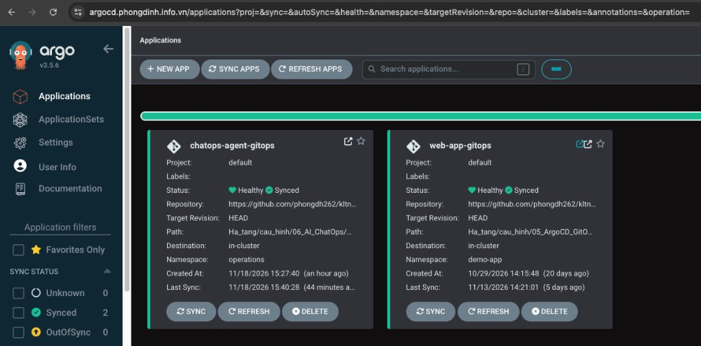

# TRIỂN KHAI QUYỀN HITL PHẠM VI HẸP VÀ SELF-MANAGED ARGO CD

- **Control Plane**: VPS 01 (`k3s-master` — `10.10.0.1/24`)
- **Argo CD Node**: VPS 02 (`k3s-worker-01` — `10.10.0.2/24`)
- **Vai trò**: Cấu hình `Role` RBAC theo `resourceNames` cho HITL (`05-hitl-scoped-roles.yaml`) và đăng ký Application `chatops-agent-gitops` trên Argo CD.

---

## 1. Phân quyền RBAC Phạm vi Hẹp (`05-hitl-scoped-roles.yaml`)

- **`Role/chatops-demoapp-operator`** (namespace `demo-app`): Cấp quyền `get, patch` trên Deployment `web-app` (`resourceNames: ["web-app"]`).
- **`Role/chatops-argocd-refresher`** (namespace `argocd`): Cấp quyền `get, patch` trên Application `web-app-gitops` (`resourceNames: ["web-app-gitops"]`).

---

## 2. Đăng ký Application `chatops-agent-gitops` trên Argo CD

Thực hiện trên **VPS 01 (`k3s-master`)**:

```bash
# 1. Áp dụng Application chatops-agent-gitops cho Argo CD
vi application-chatops-agent.yaml
kubectl apply -f application-chatops-agent.yaml

# 2. Khởi động lại Deployment để kéo image v1.2 từ GHCR
kubectl rollout restart deployment/chatops-agent -n operations
kubectl rollout status deployment/chatops-agent -n operations

# 3. Kiểm tra trạng thái đồng bộ của cả 2 Applications trên Argo CD
kubectl get applications -n argocd
```

- **Kết quả**:
  - `web-app-gitops`: `Synced` / `Healthy`
  - `chatops-agent-gitops`: `Synced` / `Healthy`


